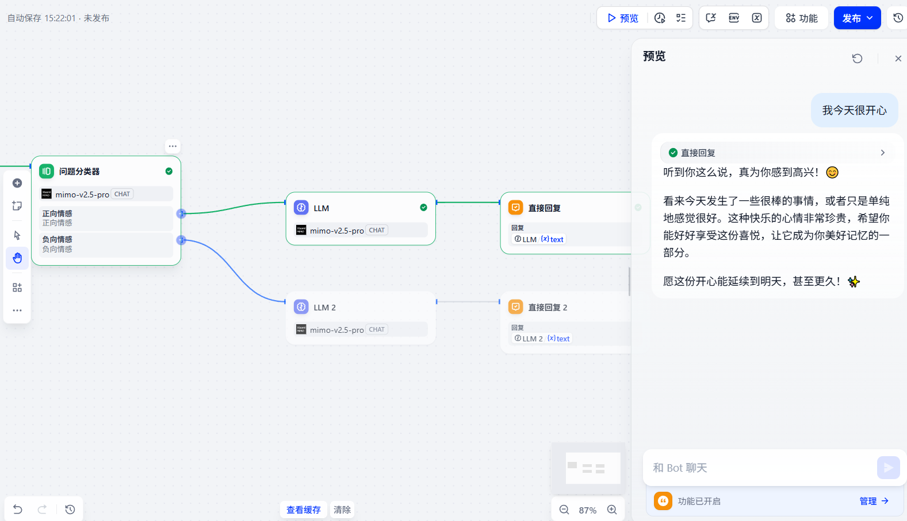
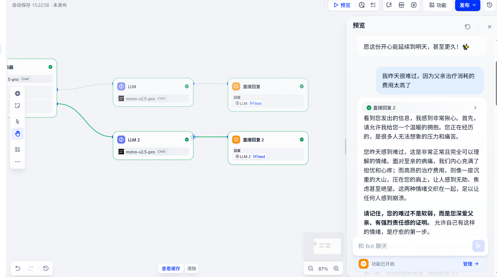
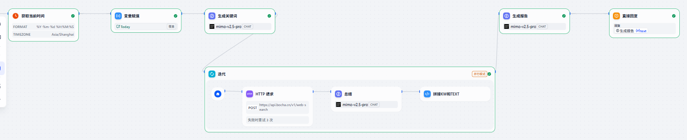
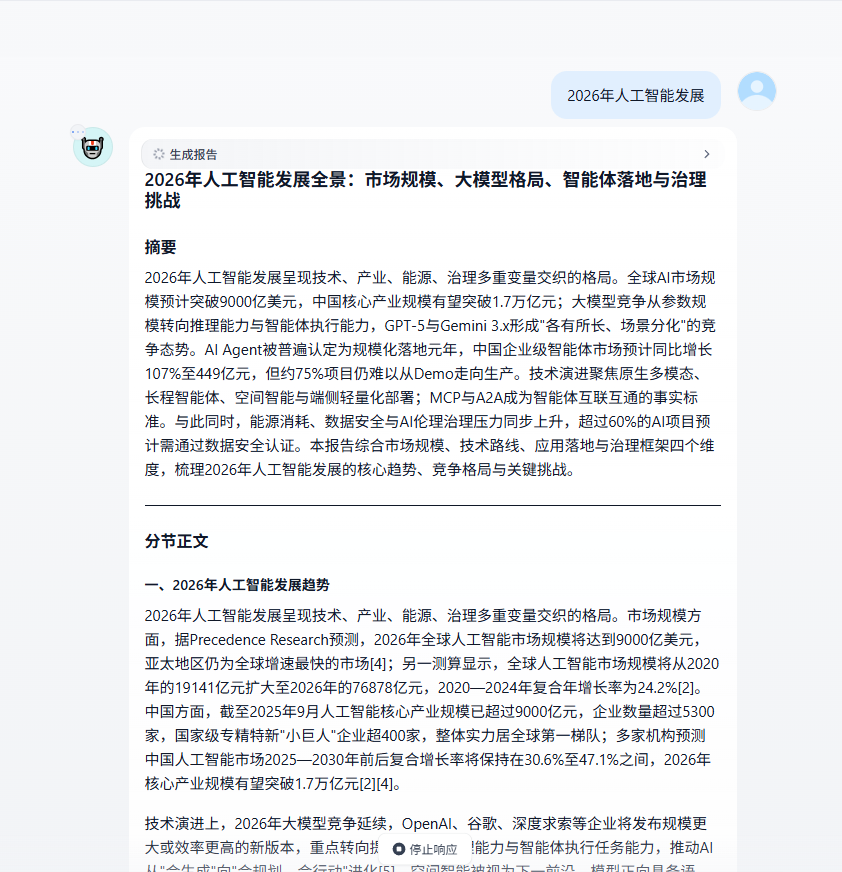

# 作业一

使用 dify 搭建一个情感分析助手，需要使用 chatflow 搭建，并运行截图，提交最终dsl。：

- 如果用户输入的是正向情感，则给用户做一个输出，希望你明天也很开心。

- 如果用户输入的一个负面情感，则对用户的困扰进行解答，并输出建议。

DSL见同文件夹附件

# 作业二

使用 dify 搭建 deepresearch 流程（低代码实现，上周是高代码实现），用户输入问题，对文本进行分解。随后调用 bocha 搜索（API），网页总结，汇总，形成报告。并运行截图，提交最终dsl。

DSL见同文件夹附件

